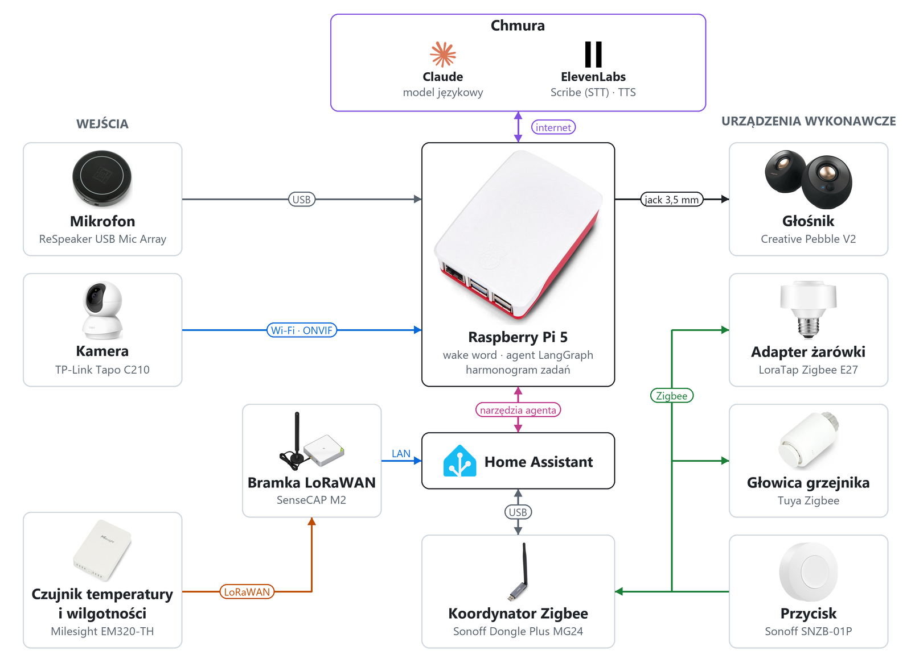

# homeloop

Domowy asystent głosowy na Raspberry Pi – projekt w trakcie budowy.



<sub>Zdjęcia produktów pochodzą ze sklepów podlinkowanych w sekcji [Sprzęt](#sprzęt). Logo z Wikimedia Commons:
[Claude](https://commons.wikimedia.org/wiki/File:Claude_AI_symbol.svg) (CC0),
[ElevenLabs](https://commons.wikimedia.org/wiki/File:ElevenLabs_Logo_01.svg) (CC BY-SA 4.0, przycięte i przekolorowane),
[Home Assistant](https://commons.wikimedia.org/wiki/File:New_Home_Assistant_logo.svg) (CC BY-SA 4.0);
znaki towarowe należą do ich właścicieli. Schemat generuje `docs/diagram.py`.</sub>

## Pomysł

Raspberry Pi w przedpokoju z głośnikiem i mikrofonem. Mówisz, mowa jest zamieniana na tekst, odpowiada
model w chmurze, a odpowiedź słyszysz głosem. Do tego czujniki (temperatura, wilgotność), kamery w pokojach i urządzenia wykonawcze
(adaptery do żarówek, głowice do grzejników, przyciski naklejane na ścianie).
Kamery w standardzie ONVIF, czujniki i aktuatory oparte o LoRaWAN lub Zigbee.

Co ma umieć:

- **Rozmowa** – „Jaka dziś pogoda?”
- **Polecenia na później** – „O 15:00 włącz światło w salonie.”
- **Reguły** – „Jak w pokoju spadnie poniżej 20°C, odkręć grzejnik.”
- **Kamery** – „Sprawdzaj co 5 minut i daj znać, jak ktoś przyjdzie do domu.”

Jak to działa:

- **Słowo wybudzające (wake word)** – rozpoznaje je lokalnie dotrenowany model.
- **Mowa (STT, TTS)** – rozpoznawanie i synteza mowy to samodzielnie napisana integracja z usługami w chmurze.
- **Model** – pętla ReAct działa bezpośrednio w Pythonie, z użyciem LangGraph. Wszystkie zasoby
  (kamery, Home Assistant itd.) model dostaje jako narzędzia.
- **Sprzęt** – integracja za pośrednictwem Home Assistant.
- **Dwie pętle** – jedna działa w czasie rzeczywistym i obsługuje polecenia głosowe, druga wywołuje
  zaplanowane zadania.

## Stack

| Obszar | Technologie |
|---|---|
| Model | Claude |
| Agent | LangGraph |
| Głos | openWakeWord (wake word), ElevenLabs Scribe (STT), ElevenLabs (TTS), sounddevice |
| Integracja ze sprzętem | Home Assistant |
| Aplikacja | Python 3.10+, NumPy, pydantic-settings |

## Sprzęt

Ceny orientacyjne, stan na listopad 2026.

### Centrala i multimedia

| Element | Model | Cena | Łączność | Zasilanie |
|---|---|---|---|---|
| Komputer | [Raspberry Pi 5, 4 GB RAM](https://botland.com.pl/moduly-i-zestawy-raspberry-pi-5/23904-raspberry-pi-5-4gb-5056561803319.html) | 515 zł | – | sieć (zasilacz USB-C) |
| Obudowa | [oficjalna obudowa Raspberry Pi 5](https://botland.com.pl/obudowy-do-raspberry-pi-5/23923-obudowa-do-raspberry-pi-5-oficjalna-czerwono-biala-5056561803340.html) | 49 zł | – | – |
| Mikrofon | [ReSpeaker USB Mic Array](https://botland.com.pl/asystenci-glosowi/15689-respeaker-usb-mic-array-asystent-glosowy-5904422377939.html) | 279 zł | USB | USB (z Raspberry Pi) |
| Głośnik | [Creative Pebble V2](https://mediamarkt.pl/pl/product/_glosniki-komputerowe-creative-pebble-v2-usb-c-czarny-1434814.html) | 110 zł | jack 3,5 mm (z ReSpeakera) | USB |
| Kamery | [TP-Link Tapo C210](https://www.x-kom.pl/p/659273-inteligentna-kamera-tp-link-tapo-c210-3mpx-led-ir-dzien-noc-obrotowa.html) | 99 zł | Wi-Fi (protokół ONVIF) | sieć (zasilacz) |

### Czujniki

| Element | Model | Cena | Łączność | Zasilanie |
|---|---|---|---|---|
| Bramka LoRaWAN | [SenseCAP M2 Multi-Platform EU868](https://botland.com.pl/sensecap-moduly-lorawan/22110-sensecap-m2-multi-platform-bramka-wewnetrzna-lorawan-sx1302-eu868-seeedstudio-114992981.html) | 489 zł | LoRaWAN, Ethernet / Wi-Fi | sieć (zasilacz) |
| Czujniki temperatury i wilgotności | [Milesight EM320-TH](https://botland.com.pl/milesight-rozwiazania-iot/29221-czujnik-temperatury-i-wilgotnosci-ip67-lorawan-milesight-em320-th-868m-6974225037865.html) | 249 zł | LoRaWAN | bateria |

### Urządzenia wykonawcze

| Element | Model | Cena | Łączność | Zasilanie |
|---|---|---|---|---|
| Koordynator Zigbee | [Sonoff Dongle Plus MG24](https://botland.com.pl/centralki-i-bramki-sieciowe/27518-sonoff-dongle-plus-mg24-bramka-zigbeethread-home-assistant-openhab-zigbee2mqtt-interfejs-usb-6920075743364.html) | 129 zł | Zigbee, USB | USB (z Raspberry Pi) |
| Adapter żarówki | [LoraTap Zigbee E27](https://www.domadoo.fr/pl/peripheriques/5807-loratap-inteligentna-oprawka-lampy-zigbee-30-kompatybilna-z-e27.html) | 37 zł | Zigbee | sieć (230 V z oprawki) |
| Głowica grzejnika | [Tuya Zigbee](https://botland.com.pl/tuya-automatyka-domowa/17148-tuya-inteligentna-glowica-termostatyczna-zigbee-5903794120495.html) | 155 zł | Zigbee | bateria |
| Przycisk na ścianę | [Sonoff SNZB-01P](https://botland.com.pl/sonoff-inteligentne-sterowniki-wifi/26572-sonoff-snzb-01p-bezprzewodowy-przycisk-aktywacji-akcji-i-scen-zigbee-6920075740615.html) | 40 zł | Zigbee | bateria |

## Stan prac

Na razie działa tylko mikrofon: `main.py` pokazuje w terminalu jego głośność.

## Uruchomienie

```powershell
py -3.10 -m venv .venv            # tylko za pierwszym razem
.\.venv\Scripts\Activate.ps1      # w każdym nowym oknie terminala
pip install -r requirements.txt   # tylko za pierwszym razem
python main.py                    # zatrzymanie: Ctrl+C
```

## Konfiguracja

Opcjonalny plik `.env` w głównym folderze projektu:

```
MIC_DEVICE=Realtek MME   # numer urządzenia albo nazwa + sterownik audio; puste = domyślny mikrofon
```

Listę dostępnych urządzeń wypisuje `python -m sounddevice`.
